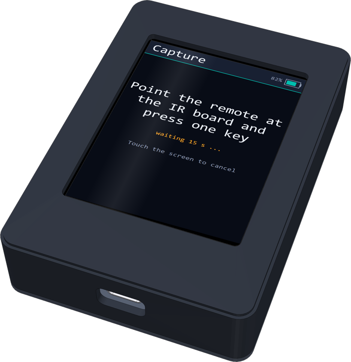
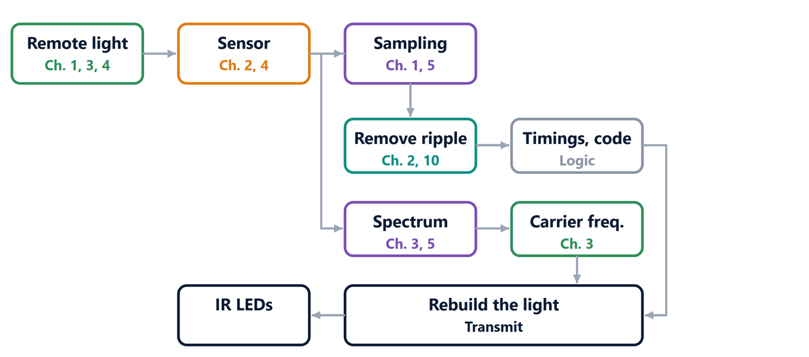
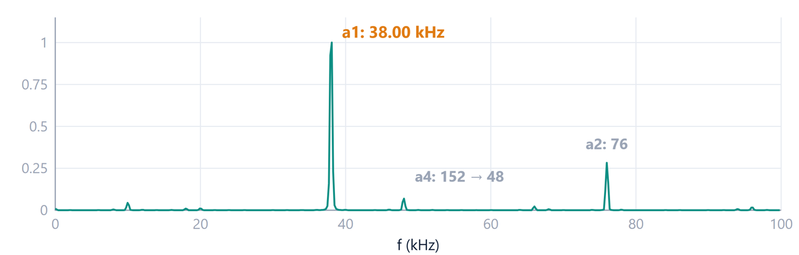
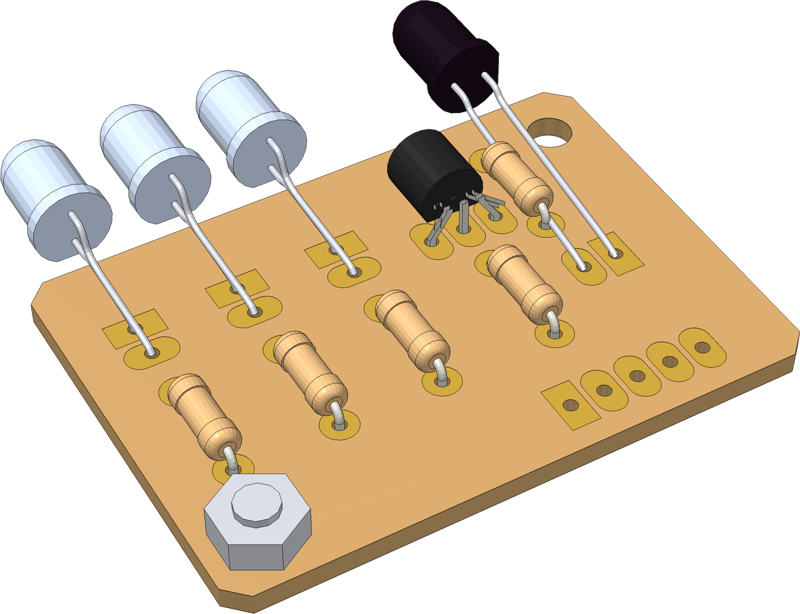
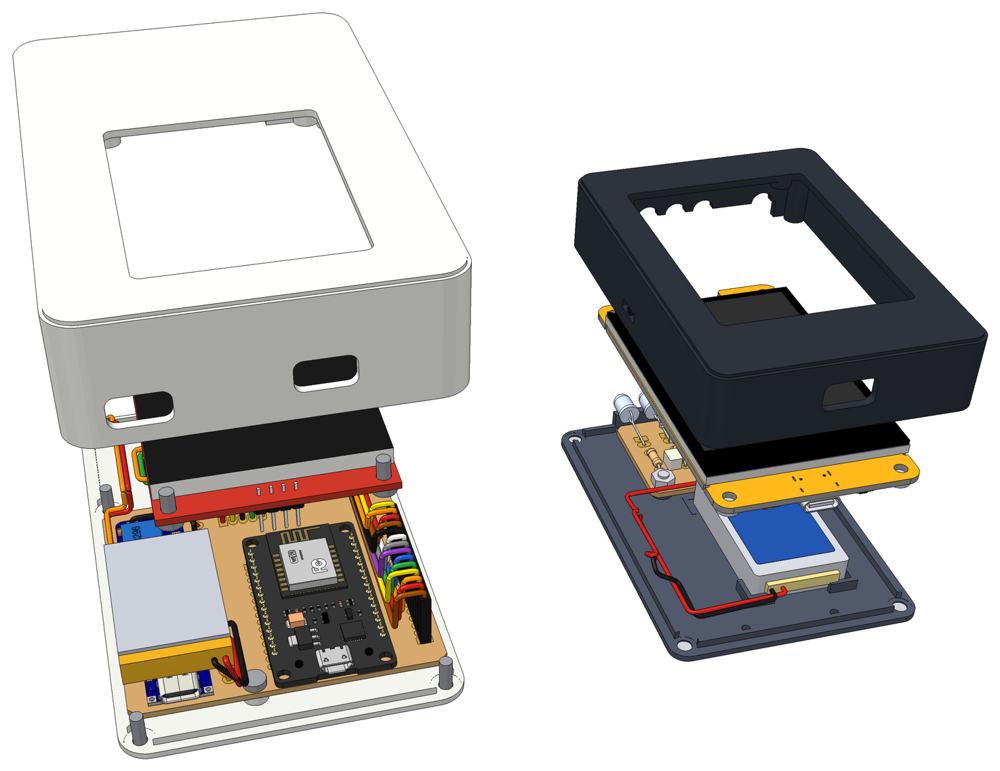
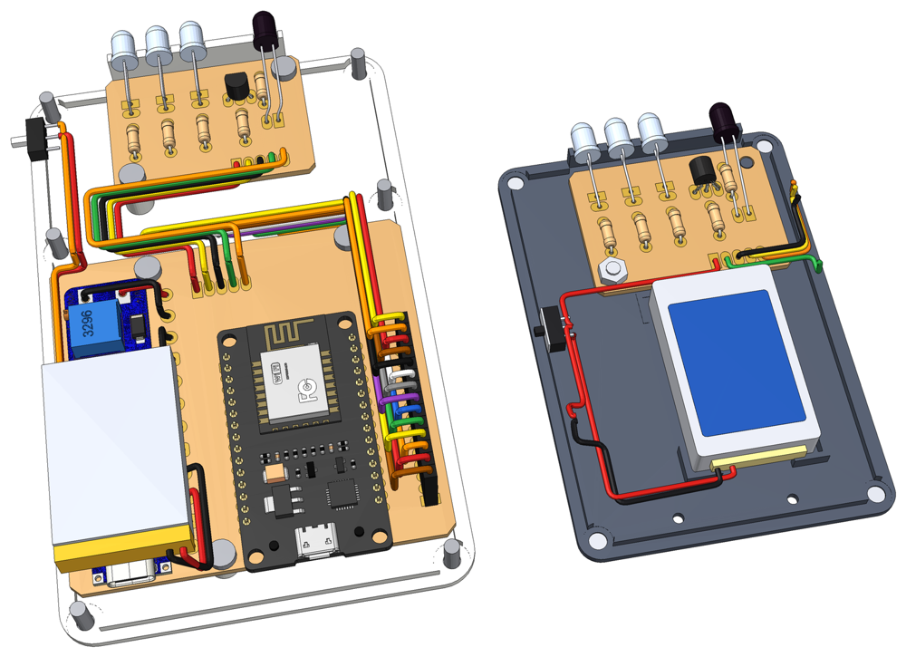

# IR Cloner & Analyzer

**EE 3521 · Signals and Systems — Islamic University of Madinah**

A handheld device that captures the signal of any infrared remote, analyzes it with the tools of the course
(sampling, convolution, Fourier series, the DFT, the Z-transform) and sends it again in place of the original remote.

<p align="center"></p>

**Team:** Talal Aljohani · Saad Obaid · Moatasim Ahmad · Yousef Ahmed
**Supervisor:** Dr. Abdulmajeed Alenezi

---

## Where the course is in the code

The firmware is 3,746 lines, but most of it is the touch screen, the menus, storage and the battery.
The signal processing that belongs to the course is in a few short places. Each link opens the exact lines.

| Step | Chapter | What it does | Code |
|---|---|---|---|
| 1. Sampling | Ch. 1 | x[n] = y(nTs), fs = 200 kSa/s, ω0Ts = 0.38π < π (no aliasing) | [`config.h:31`](firmware/IR_Cloner/config.h#L31), [`adc_stream.cpp:51`](firmware/IR_Cloner/adc_stream.cpp#L51) |
| 2. Envelope | Ch. 2, 10 | Max of every 50 µs window removes the carrier; ambient light tracked by y[n] = (31/32)y[n−1] + (1/32)x[n] | [`ir_rx.cpp:145-149`](firmware/IR_Cloner/ir_rx.cpp#L145-L149), [`ir_rx.cpp:83`](firmware/IR_Cloner/ir_rx.cpp#L83) |
| 3. Mark / space and durations | Ch. 2 | Threshold decision; the sensor's convolution stretches marks and shortens spaces | [`ir_rx.cpp:102`](firmware/IR_Cloner/ir_rx.cpp#L102), [`ir_rx.cpp:107-108`](firmware/IR_Cloner/ir_rx.cpp#L107-L108) |
| 4. Carrier frequency | Ch. 3, 5 | Square-wave Fourier series (a₁ at f0); Hann window + FFT (= DFT), peak between 25 and 60 kHz | [`dsp.cpp:47-54`](firmware/IR_Cloner/dsp.cpp#L47-L54), [`ir_rx.cpp:240`](firmware/IR_Cloner/ir_rx.cpp#L240) |
| 5. NEC decoding | logic, Ch. 2 | Each bit read from mark + space (the sum is not changed by the convolution); inverse-byte check | [`ir_decode.cpp:50-52`](firmware/IR_Cloner/ir_decode.cpp#L50-L52), [`ir_decode.cpp:56`](firmware/IR_Cloner/ir_decode.cpp#L56) |
| 6. Transmit | Ch. 1, 2 | Remove the convolution stretch, then the RMT builds x(t) = m(t)·c(t) | [`ir_decode.cpp:171-174`](firmware/IR_Cloner/ir_decode.cpp#L171-L174), [`ir_tx.cpp:15`](firmware/IR_Cloner/ir_tx.cpp#L15), [`ir_tx.cpp:44`](firmware/IR_Cloner/ir_tx.cpp#L44) |
| Math screen: RC | Ch. 2, 4 | RC = (t₂ − t₁)/ln 9 from the 90 %→10 % fall; H(jω) = 1/(1 + jωRC) | [`app.cpp:1074`](firmware/IR_Cloner/app.cpp#L1074) |
| Math screen: Z | Ch. 2, 5, 10 | y[n] = a·y[n−1] + (1−a)·x[n], H(z) = (1−a)/(1 − a z⁻¹), pole a = 0.905 (stable) | [`app.cpp:1209`](firmware/IR_Cloner/app.cpp#L1209), [`app.cpp:1169`](firmware/IR_Cloner/app.cpp#L1169) |

All of these steps are also collected in one short, commented file that runs on any PC:
[`firmware/Signals_Core.cpp`](firmware/Signals_Core.cpp). It runs the whole chain on a simulated remote press and prints
each result (`g++ -O2 -o core Signals_Core.cpp && ./core`).

<p align="center"></p>

## How it works

1. **Sampling (Ch. 1).** The photodiode turns the IR light into a voltage y(t). The ESP32 ADC samples it at
   200 kSa/s (Ts = 5 µs) through DMA. The 38 kHz carrier becomes ω0Ts = 0.38π < π, so there is no aliasing;
   at 50 kSa/s it would be 1.52π and show up as 12 kHz (shown on the Experiment screen).
2. **Envelope (Ch. 2, 10).** The maximum of every 10 samples (50 µs, longer than one 26 µs carrier period)
   removes the carrier ripple. Ambient light is followed by a first-order low-pass difference equation and subtracted.
3. **Mark / space (Ch. 2).** A threshold turns the envelope into marks and spaces; their durations are the message m(t).
   The sensor is a slow LTI system, h(t) = (1/RC)·e^(−t/RC): the convolution makes every mark longer and the next space shorter.
4. **Carrier (Ch. 3, 5).** 1024 samples from inside the first mark, Hann window, FFT; the highest peak between
   25 and 60 kHz is the carrier (a₁ of the square wave, 38.00 kHz on our remotes). Bin width fs/N = 195 Hz.
5. **NEC decoding.** Each bit is read from mark + space (1.125 ms = 0, 2.25 ms = 1), so the convolution stretch cancels.
   Other protocols are kept as raw timings.
6. **Transmit (Ch. 1).** The stretch is removed, then the ESP32 RMT peripheral rebuilds x(t) = m(t)·c(t) with the
   measured carrier and a 1/3 duty cycle, and drives three IR LEDs through a 2N2222 transistor.

The **Math** screen applies the course to your own capture: it measures the sensor RC from the 90 %→10 % fall
(≈ 61 µs on our board), plots |H(jω)|, and runs y[n] = a·y[n−1] + (1−a)·x[n] with its pole on the z-plane.

<p align="center"></p>

## Documents

| File | Language | Contents |
|---|---|---|
| [Study Guide](docs/Study_Guide_EN.pdf) | English | The code that matters for the course, step by step, with a glossary of every term |
| [Study Guide](docs/Study_Guide_AR.pdf) | Arabic | The same guide in Arabic |
| [Theory Tutorial](docs/Theory_Tutorial_AR.pdf) | Arabic | The full theory, matched to the course chapters (1, 2, 3, 4, 5, 10) |
| [Code Guide](docs/Code_Guide_AR.pdf) | Arabic | Line-by-line walk through every signal-processing function |
| [User Guide](docs/User_Guide_AR.pdf) | Arabic | How to use every screen of the device |
| [Presentation](docs/Presentation_EN.pdf) | English | The project presentation |

## Repository layout

```
firmware/
  IR_Cloner/          Arduino sketch for the ESP32 (open IR_Cloner.ino)
    config.h          all constants: sample rate, window, pins, carrier
    adc_stream.cpp    step 1: 200 kSa/s ADC with DMA
    ir_rx.cpp         steps 2-3: envelope, mark/space, durations, carrier estimate
    dsp.cpp           step 4: Hann window, FFT, peak, aliasing
    ir_decode.cpp     step 5: NEC decoding, timing correction before sending
    ir_tx.cpp         step 6: x = m * c with the RMT peripheral
    app.cpp           screens and menus (Math screen: fitRc, Z page)
    touch_xpt2046.cpp, storage.cpp, power.cpp   touch, saved signals, battery (not course material)
  Signals_Core.cpp    the whole signal chain in one PC program, for study
  tools/plot_capture.m  MATLAB script: plot a raw ADC dump (time signal + spectrum)
hardware/
  ir_board/           KiCad 10 project of the IR board (receiver + 3 LEDs), with fab files (schematic, BOM, gerbers)
  case/               3D-printed case (STL) and the Autodesk Fusion script that builds it
docs/                 guides and presentation (PDF)
images/               pictures used in this README
```

## Hardware

- **Main board:** lcdwiki E32R28T "Cheap Yellow Display" (CYD) (ESP32 + 2.8 in ILI9341 touch screen + battery charger).
- **IR board (ours):** photodiode receiver on GPIO35 (ADC1 channel 7) and three IR LEDs driven by a 2N2222 on GPIO27.

<p align="center">


</p>

The first version used our own main board with an ESP32 module, a separate display, a charger and a boost converter (six modules, 31 wires). The final version uses one CYD board plus our IR board
(old on the left, new on the right):

<p align="center"></p>

## Building the firmware

| Setting | Value |
|---|---|
| Board package | esp32 by Espressif, version 3.x (tested on 3.3.11) |
| Board | ESP32 Dev Module |
| Partition scheme | Default 4MB with spiffs |
| Libraries | Adafruit ILI9341, Adafruit GFX, Adafruit BusIO |

Open `firmware/IR_Cloner/IR_Cloner.ino` in the Arduino IDE and upload. The FFT and the touch driver are written inside the
project, so no other libraries are needed. Serial Monitor at 115200 shows the measured ADC rate at start-up.
